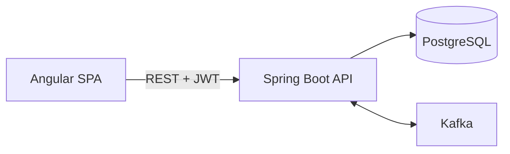
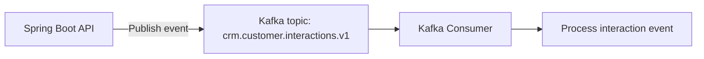
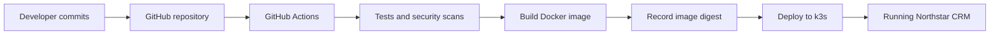

# Architecture

## Mandatory runtime path
Angular → REST over HTTP → Spring Boot API → PostgreSQL  
Spring Boot ↔ Kafka

- Angular provides the customer and interaction user interface.

- REST endpoints connect Angular to Spring Boot.

- Spring Boot validates requests, enforces authentication and authorization, and implements business logic.

- PostgreSQL stores persistent customer and interaction data.

- Kafka carries versioned events for asynchronous processing.

- Angular attaches JWTs to authenticated requests. Spring Boot validates tokens and enforces access control.

## Mandatory delivery path
GitHub → GitHub Actions → tests and security checks → Docker image → k3s deployment

## Non-goals
- Bitbucket Pipelines
- Oracle
- React
- SOAP

## Application architecture

## Messaging architecture

## Delivery architecture

## ADRs 
1. Database: PostgreSQL is the selected database for the Capstone. It supports relational data and Flyway migrations.

2. CI/CD: GitHub Actions is the selected pipeline platform. Selected because the project is hosted on GitHub and Actions can run pull-request checks, tests, security scans, and deployment workflows.

3. Deployment: k3s is the target Kubernetes environment. It is lightweight and practicing container orchestration and deployment.

## Test fixtures

- CUS-1001 — Amina Khan

- CUS-1002 — Ravi Singh

- CUS-9999 — nonexistent customer

- lab-request-001 — standard correlation ID
